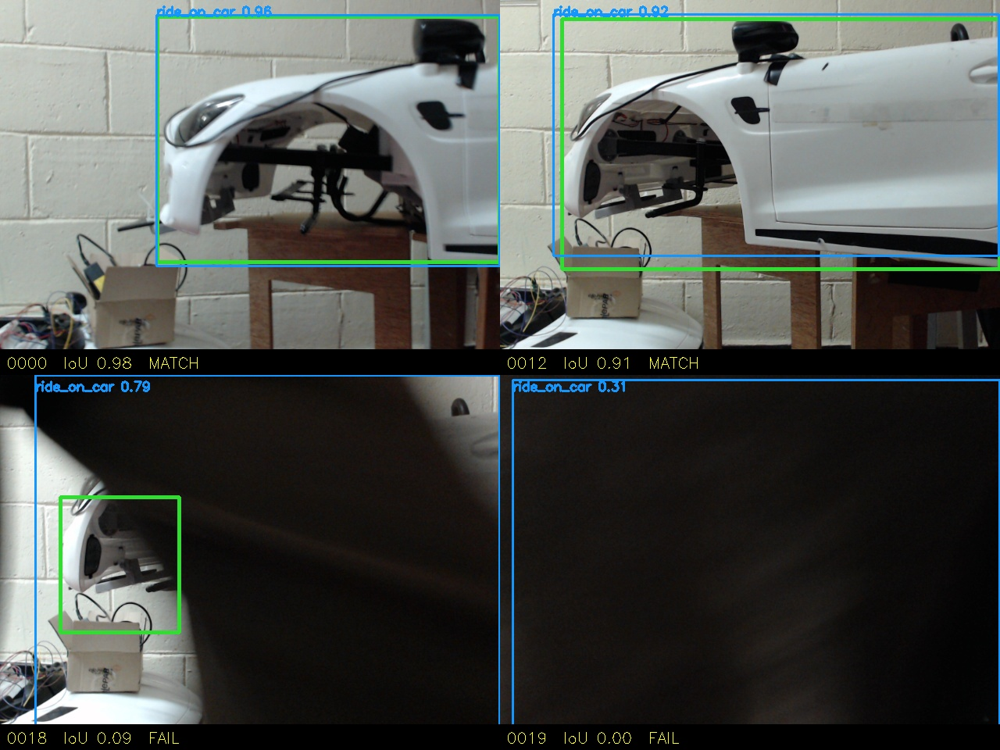

# 차 옆면 인식 오프라인 재검증 — 2026-11-19

원격 `main`의 `60271d6`을 가져와 새 전동차 전용 `ride_on_yolo11n.pt`를 직접 실행했다.
기존 root `best.pt`는 이번 평가에 사용하지 않았다. 어제 표시한 범용 MobileNet-SSD와,
원격에 추가된 COCO YOLO11n 및 합성 전동차 데이터로 전이학습한 YOLO11n을 비교했다.
이번 검증에서 추가 학습, 가중치 갱신, 테스트 영상으로 체크포인트 선택은 하지 않았다.

## 데이터와 판정

- 실제 C920 녹화 `mvsim_slam_real/artifacts/sensor_compare_push/20261118_155446`의 43장 전체.
- 차체가 보이는 42장: 가림이 없는 옆면 41장 + 손에 가려 일부만 보이는 0018 한 장.
- 차체가 보이지 않는 0019 한 장은 렌즈 가림 음성 예시.
- 기존 12장 평가의 수동 박스를 유지하고, 나머지 31장은 콘택트 시트에서 보이는 차체의
  범위를 수동으로 근사 표시했다. 받침대는 제외했다. 주석 출처를 `annotations.json`에 기록했다.
- 신뢰도 0.25에서 목표 클래스 출력만 평가, 정답 박스와 IoU ≥ 0.50이면 한 건 검출 성공.
  겹침이 부족한 출력은 오검출이고 해당 양성 프레임은 동시에 미검출로 계산한다.
- YOLO 입력 416, CPU, 배치 1. MobileNet은 본래의 300×300 입력과 전처리를 사용한다.
  서로 구조가 다르므로 비교 수치는 각 도구의 결과이지 동일 연산량 벤치마크는 아니다.

## 결과

| 모델 | 차체가 있는 42장 중 일치 | 미검출 | 정답과 일치하지 않는 출력 박스 | 차체 없는 1장에서 출력 |
|---|---:|---:|---:|---:|
| 전동차 전용 YOLO11n | 41/42 | 1 | 2 | 1 |
| COCO YOLO11n `car` | 2/42 | 40 | 0 | 0 |
| 어제의 MobileNet-SSD `car` | 1/42 | 41 | 0 | 0 |

전동차 모델은 가림 없는 옆면 41장에서 모두 일치했다. 이 41장의 평균 최선 IoU는 약 0.917이다.
기존 평가 표본 12장도 양성 11장 중 10장 일치, 오검출 2건으로 원격 기록과 같은 결과가 나왔다.
반면 MobileNet을 어제 실시간 설정인 신뢰도 0.65로 평가하면 `car` 일치는 0/42다.
그 설정에서 다른 종류로 나온 출력은 `aeroplane` 14건, `chair` 5건, `pottedplant` 2건이다.

### 가림에서의 실패

- **0018:** 차체가 일부 남았지만 가림을 포함한 큰 영역을 차로 판단. 신뢰도 약 0.79,
  IoU 약 0.09로 일치 실패. 단순히 신뢰도를 0.5 또는 0.65로 올려도 남는다.
- **0019:** 차체가 보이지 않는 렌즈 가림 장면에서 신뢰도 약 0.31의 차 박스가 발생.
- 신뢰도 0.5 또는 0.65에서는 41/42 일치와 오검출 1건, 음성 1장 무출력.
- 신뢰도 0.8에서는 오검출이 사라지지만 정상 프레임 0017도 놓쳐 40/42로 감소.
  이 관찰만으로 운영 임계값을 확정하지 않는다.



## 해석과 한계

이 녹화의 차 옆면을 찾는 데 전동차 전용 모델은 범용 모델보다 크게 개선됐다.
근접해 차체가 화면 밖으로 잘린 상태에서도 **보이는 차체 영역**을 검출했다.
따라서 어제의 인식 실패를 촬영 환경이나 거리만의 문제로 해석할 수 없다.

하지만 이 수치는 일반적인 차종/장소에 대한 97.6% 정확도가 아니다. 모두 같은 날 같은 차체를
찍은 한 회차의 이웃 프레임이다. 이 실제 영상은 학습 입력/합성 검증 입력에 쓰이지 않았다는
원격 기록이 있으나, 같은 촬영의 한 장을 참조한 합성 예시가 생성 구도의 참고 자료였다.
따라서 독립적인 외부 검증으로 간주하지 않는다. 추가 31장의 정답도 픽셀 단위 정밀 라벨이
아닌 수동 근사 박스다. 배경만 보이는 정상 장면은 없고 음성은 렌즈 가림 한 장뿐이다.

밝기, 배경, 차체 종류, 거리별 일반화와 지속적인 가림을 별도 회차에서 검증해야 한다.
이 검증은 영상 박스 평가이며 LiDAR 물체 대응, 거리 정확도, 주차 성공을 검증하지 않는다.
이어 수행한 ROS 통합 작업에서 카메라 주차 모드와 실시간 비교 도구의 기본 검출기를
전동차 ONNX 모델로 바꿨다. 아래는 그 실제 실행 백엔드를 별도로 재검증한 결과다.

### ROS용 ONNX 실행 백엔드 검증

ONNX Runtime 1.20.1, OpenCV 4.5.4, NumPy 1.24.4의 별도 ROS용 환경에서 같은 43장을 실행했다.
정적 416×416 letterbox 입력, 신뢰도 0.65에서 양성 42장 중 41장 일치, 미검출 1건,
정답과 겹침 부족한 출력 1건, 차체 없는 0019는 무출력이었다. 평균값이 아닌 추론 시간 중앙값은
약 16ms(이 PC CPU, 모델 준비 후의 43장)였다. 상세 결과는 `ros_runtime_onnx.json`에 있다.
PyTorch 평가의 기본 직사각형 패딩과 ONNX의 정적 정사각형 패딩은 입력 구도가 달라
신뢰도 값은 직접 동일하게 해석하면 안 된다. 실제 주차 노드의 인식 입출력은 이 ONNX 백엔드를 사용한다.

별도 테스트에서 실제 영상 입력에 **합성으로 명시한 스캔·외부 보정·TF·지도**를 연결해,
첫 차량만 관측했을 때는 목표 미확정, 자기 차량 이동 후 두 번째 차량을 관측했을 때는
3.3m 좌측 공간 확정으로 이어지는지 확인했다. 실측 보정이 없는 실제 저장 데이터에는
영상 후보만 발행하며 물체 대응은 무효로 유지한다. 이 테스트도 현장 융합 성공의 근거는 아니다.

## 재현

별도 가상환경에서 PyTorch 2.6.0+cpu, torchvision 0.21.0+cpu, Ultralytics 8.4.172,
OpenCV 4.11.0, NumPy 2.2.6으로 실행했다. OpenCV 5에서는 Caffe 로더가 없어
MobileNet 비교를 위해 이 평가 환경의 OpenCV를 4.11로 고정했다. ROS 시스템 Python은 변경하지 않았다.

```bash
uv venv .venv-parking-linux --python /usr/bin/python3
uv pip install --python .venv-parking-linux/bin/python torch==2.6.0 torchvision==0.21.0 \
  --index https://download.pytorch.org/whl/cpu
uv pip install --python .venv-parking-linux/bin/python ultralytics==8.4.172 opencv-python==4.11.0.86 numpy==2.2.6
# 원격 README의 공식 다운로드로 artifacts/ride_on_detector/yolo11n.pt를 준비한다.
# 전동차 가중치는 Git LFS, MobileNet 가중치는 tools/setup_sensor_compare_model.sh로 받는다.
.venv-parking-linux/bin/python tools/evaluate_side_capture.py
```

결과는 `mvsim_slam_real/artifacts/side_vehicle_eval_20261119/`의 `evaluation.json`과
각 모델의 `*_all43.jpg`에 저장된다. 이 폴더는 Git 기본 제외 경로다.
전동차 가중치 SHA-256: `55e096b0036823bad3f73a40320f982fc9e690c5fe375748199dc3ca205b113e`.
COCO 가중치 SHA-256: `0ebbc80d4a7680d14987a577cd21342b65ecfd94632bd9a8da63ae6417644ee1`.
