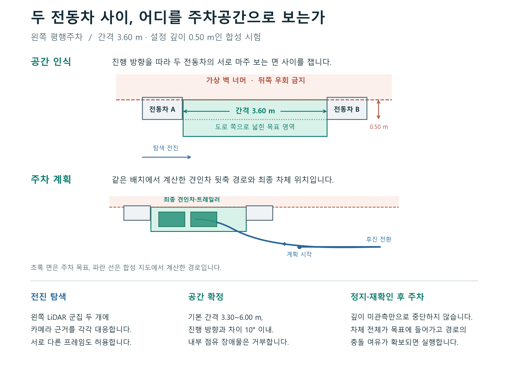

# 왼쪽 두 구조물 주차 테스트

최종 미션 배치는 **출발 위치에서 전진 → 좌측 네 칸의 1·4번 정지차를 순차 관측 →
가운데 2·3번을 하나의 공간으로 확정 → 트랙터·트레일러 전체 평행주차**입니다.
참고 평가 PDF의 수직주차 배치를 우리 과제에 맞게 변경한 정의이며,
두 차량을 한 카메라 프레임에서 동시에 볼 필요는 없습니다.
요구사항·센서 역할·검증 기준은 [최종 미션 정의](../../docs/left_parallel_parking_mission.md)를 봅니다.

최종 동작은 **시작 명령 → 자동 전진 탐색 → 카메라/LiDAR로 두 구조물 확인 →
공간 확정 → 기존 Final B 경로계획·주차 제어**입니다. 손으로 미는 방식은
`manual_survey:=true` 중간 검증 옵션입니다. 기존 `real_parking.launch.py`의
U자 공간 검출 기본 동작은 그대로 유지됩니다. 두 실행을 동시에 띄우지 않습니다.

## 최종 목표와 단계별 판정

최종 목표는 **전진하면서 왼쪽 공간을 카메라+LiDAR로 인식하고 → 주차 동작을 계획하고 →
실제 차량·트레일러를 주차시키는 것**입니다. 전진 탐색은 사람이 뒤에서 밀거나 모터로 수행할 수 있습니다.
손으로 밀기 모드에서는 정지 후 시작 버튼으로 계획에 넘깁니다. 실차 출력을 켠 경우 경로를 따라 주차합니다.
LiDAR 단독 모드는 센서·검출을 분리 확인하는 중간 시험이며 최종 카메라+LiDAR 동작과 구분합니다.

좁은 복도에서는 공간 인식에 성공해도 주변 벽 때문에 실행 가능한 경로가 없을 수 있습니다.
공간 인식, 경로 생성, 실제 주차 완료를 각각 판정하며, 계획 실패를 공간 탐색 실패로 바꾸지 않습니다.
실제 구동은 유효한 경로와 기존 구동 조건이 갖춰진 경우에만 진행합니다.
이 목표를 문서화한 것이 실차 인식·주차 성공을 검증했다는 뜻은 아닙니다.

기본 자동 전진 탐색은 같은 공간을 새 지도 3장에서 확인한 뒤, 트레일러 후단이 두 번째
구조물을 지나면 멈춥니다. 전진 정지 여유가 먼저 부족해지면 그 위치에서 멈춥니다.
정지 후에는 최신 위치 추정으로 약 1초 동안 움직임이 없는지 확인하고, 새 지도 3장에서
공간을 재확인합니다. 계획기는 실제 정지 위치 주변의 대기 자세를 먼저 검사합니다.

## 공간 정의



그림의 3.30 m는 이전 검출 하한입니다. 현재 하한과 정지 기준은 아래 값을 사용합니다.

- 초기 진행방향의 왼쪽(+Y)에 있는 LiDAR 구조물 두 개가 필요합니다. 구조물은 가로·세로·높이
  30 cm 이상을 가정합니다. **구조물은 LiDAR 스캔 높이보다 높아야** 점으로 잡힙니다. 현재
  `vehicle_geometry.yaml`의 실측 LiDAR 높이는 **0.687 m**(옆 방향은 수평, 앞으로 1.4° 숙임)이므로 왼쪽
  구조물은 약 0.75 m 이상이어야 합니다. 30~41 cm 구조물(전동차 포함)을 쓰려면 LiDAR를 그보다 낮게 달고
  `lidar_mounting_offset`을 다시 측정해야 합니다.
- 구조물이 건물 벽에 붙어 있어도 됩니다. 길이 3 m가 넘는 점유 덩어리(벽)에서 도로 쪽으로
  `pair_structure_protrusion_m`(0.15 m) 이상 튀어나온 부분을 구조물로 분리합니다.
- 구조물의 도로 쪽 표면 위치로 입구와 방향을, 서로 마주 보는 경계로 길이를 계산합니다.
- 깊이(공간 폭)는 `config/two_structure_test.yaml`의 `slot_width: 1.10` m입니다.
  두 구조물 사이 뒤쪽에 벽이 입구에서 `slot_width`보다 가까이 있으면 **공간 안쪽 끝을 그 벽에
  맞추고**, 공간이 도로 쪽으로 나옵니다(예: 깊이 0.55 m 구조물이 벽에 붙어 있으면 공간의 절반가량이
  구조물 앞면보다 도로 쪽). 벽 근거는 긴 벽이나 1 m 이상(`pair_min_wall_piece_m`)인 벽 조각만
  씁니다. 공간 안의 짧은 물체는 벽으로 보지 않고 장애물로 거부합니다.
  벤츠 NEW GTR AMG 표기 크기 0.99 × 0.55 × 0.41 m의 폭을 기준으로 한 초기값이며
  실제 진입 가능 여부는 기존 전체 견인차·트레일러 충돌 검사와 경로계획으로 판단합니다.
- `slot_width:=1.20`처럼 실행 시 바꾸거나 YAML을 수정하고 재시작할 수 있습니다.
  설정 깊이가 차체 폭 + 0.36 m보다 작으면 안쪽 경계(가상 벽)를 고정하고
  목표 사각형의 도로 쪽 경계를 넓힙니다. 최종 차체 일부가 두 구조물 앞면보다 도로 쪽에 올 수 있습니다.
  자동 탐색/주차가 시작된 뒤에는 검출 파라미터 변경을 거부합니다.
- 뒤쪽 벽을 요구하지 않으며 공간 검출에서는 가상의 벽이나 빈 셀을 만들지 않습니다.
  목표 사각형 내부(경계에서 0.10 m 안쪽)에 `pair_max_speck_cells`(기본 2개)를 넘는
  연결된 점유 셀이 있으면 후보를 거부합니다. 미관측 비율만 `pair_max_unknown_fraction`
  (기본 10%)을 넘으면 두 구조물의 간격과 카메라 확인으로 목표를 넘깁니다.
  이때 계획·실행 격자에서 미관측 셀은 막힘으로 유지하며, 빔 사이 빈틈도 메우지 않습니다.
  차체 전체가 들어갈 목표 자세와 0.18 m 여유를 가진 경로가 있어야 주차가 진행됩니다.
- 깊이 관측이 허용치 안인 목표에만 기존 `pair_bay_unknown_as_free` 설정을 적용합니다.
- 공간 확정 후에는 경로계획·실행 전 재검사·실행 중 충돌 검사 격자에서 공간 안쪽 끝
  (목표 사각형 중심에서 목표 폭의 절반 + `pair_rear_block_margin_m`)보다 깊은 영역을 지도 전체 길이로
  점유 처리합니다(`pair_block_behind_bay: true`, 여유 기본 0.0 m). 벽 없는 곳에서 트레일러가
  구조물 뒤편으로 돌아 들어가는 경로를 막아 "전진으로 지나친 뒤 후진 진입, 필요하면 공간 안
  전후 보정"만 남깁니다. 공간 검출 지도와 전진 탐색에는 적용하지 않으며, 경로가 없으면
  기존처럼 FAILED로 멈춥니다.
- 검출 기본 간격은 2.60~6.00 m이며 실제 견인차·트레일러 전체 길이 + 0.36 m도 충족해야 합니다.
  실제 진입은 계획에서 판정합니다. 이전 합성 시험에서는 3.30 m에서 여러 번 전후진이
  필요했고, 3.60 m에서 한 번의 후진으로 진입했습니다. 처음에는 3.60 m 배치로 시험합니다.
  카메라 모드의 기본 검출기는 전동차 전용 `ride_on_yolo11n` ONNX 모델입니다.
  `ride_on_car` 라벨과 신뢰도 기본 0.65를 통과한 대응 점만 차량 증거로 누적합니다.
  기존 색상·윤곽 방식은 `detector_backend:=heuristic` 진단 옵션으로 명시해서 고릅니다.

## 구조물·벽 배치 기준

거리는 **시작 위치의 주행선(뒷바퀴 축 중심선)** 기준입니다. 차폭은 0.55 m라 차 옆면은 주행선에서 0.275 m입니다.

- **구조물이 벽에 붙어 있어도 됩니다.** 벽과 구조물 사이를 띄울 필요는 없습니다. 구조물이
  벽보다 도로 쪽으로 0.15 m 이상 튀어나오기만 하면 됩니다(구조물 깊이 30 cm 이상이면 만족).
- **왼쪽 구조물 앞면까지 거리**: 검출 허용 0.55~6 m. 권장 **0.8~1.5 m**(차 옆면과 구조물 사이 약 0.5~1.2 m).
  - 0.55 m 근처는 전진 탐색 중 0.18 m 충돌 여유와 주행 흔들림(최대 옆 1 m 허용) 때문에 비상정지 위험이 큽니다.
  - 벽 없는 열린 곳에서는 무반사 광선을 기본 3 m까지만 빈 공간으로 기록합니다. 더 먼 곳의 깊이가
    미관측이어도 공간을 확정할 수 있지만, 경로에 필요한 도로와 목표 자세의 여유는 지도에서 확보돼야 합니다.
- **오른쪽**: 공간 검출은 오른쪽을 보지 않습니다. 다만 두 가지는 남습니다.
  - 전진 탐색·주차 중 차체에서 **0.18 m 안에 들어오는 점유 셀은 어느 쪽이든 충돌로 보고 멈춥니다**(안전 장치라 유지).
  - 후진 진입 때 차 앞부분이 오른쪽으로 돕니다. 합성 시험(간격 3.6 m)에서 출발 시 차 오른쪽 면보다
    구조물 앞면 0.6 m일 때 0.37 m, 0.8 m일 때 0.2 m, 1.0~2.0 m일 때 0.05~0.1 m 더 나갔습니다.
    여기에 0.18 m 여유를 더해 **차 오른쪽 면에서 약 0.3 m(구조물이 가까우면 0.55 m)** 를 비워 두세요.
  - 재현: `PYTHONNOUSERSITE=1 python3 tools/two_structure_lateral_sweep.py` (빌드된 워크스페이스).

## 카메라 설치

먼저 저장소 루트의 LFS 전동차 가중치 두 개(`ride_on_yolo11n.pt`, `ride_on_yolo11n_wheels.pt`)가 준비돼
있는지 확인하고, 실차 워크스페이스에서 `bash tools/prepare_ride_on_runtime.sh`를 실행해 두 모델의 ONNX를 준비합니다.
학습 환경과 ROS 추론 환경은
각각 `.venv-parking-linux`와 `.venv-vision-ros`로 분리합니다. 시스템 Python 패키지를 바꾸지 않습니다.
카메라 모드 또는 카메라 장치를 지정한 모드에서는 `detector_backend:=auto`가 전동차 모델을 선택합니다.
장치 없는 LiDAR 단독 모드의 비전 진단은 기존 방식으로 남으며 모델/추론 환경을 요구하지 않습니다.

GUI의 **연결 설정 → 전동차 ONNX 모델**에서 **기존 모델** 또는 **바퀴 장착 보강 모델**을 선택합니다.
기존 모델이 기본이며, 설정은 다음 테스트 실행 시 적용됩니다. 원하는 ONNX 경로를 직접 입력할 수도 있습니다.
`차체 검출 신뢰도` 기본값은 두 모델 모두 0.65입니다. CLI에서 바퀴 장착 보강 모델을 고를 때는
`detector_model:="$(realpath ../artifacts/ride_on_detector/ride_on_yolo11n_wheels.onnx)"`를 추가합니다.
CLI에서 다른 모델이나 임계값을 쓰려면 `detector_model:=/실제/model.onnx detector_confidence:=0.65`로 지정하고,
다른 ROS용 가상환경을 쓰면 `vision_python:=/가상환경/bin/python`을 지정합니다.
모델/실행 환경이 없거나 모델 클래스가 다르면 오류로 중단하며 색상 검출로 자동 대체하지 않습니다.
영상 구독은 전동차 모드에서 reliable입니다. 외부 best-effort 영상 발행기에 연결할 때만
`image_reliability:=best_effort`를 명시합니다.

카메라를 고정한 뒤 기존 [카메라/LiDAR 보정 형식](../README.md#라바콘흰색-전동차-후보-및-라이다-겹침-확인)으로
내부 파라미터·왜곡·LiDAR→카메라 회전/이동값을 실측합니다.
왼쪽 한뼘 반/아래 10 cm라는 대략값을 실측 변환으로 저장하지 않습니다.
장착 각도가 바뀌면 다시 보정해야 합니다. LiDAR 스캔 높이와 카메라 시야 모두에
구조물이 잡히는지 먼저 확인합니다.
전동차 근접 검출 모델의 학습·오프라인 평가 기록은
[전동차 근접 인식 시험](../../artifacts/ride_on_detector/README.md)을 참고하세요.

보정 파일이 없으면 영상 검출과 LiDAR 공간 후보는 표시하지만 결합 확인과 자동 주행 시작은
거부합니다. 이미지/스캔 시각 차이는 최대 0.10 s이며 스캔 중 움직임의 deskew는 없습니다.
영상이 0.5초 이상 오래됐거나 추론 중 오래되면 무효화하며, 추론과 스캔 수신 콜백은 별도로 실행합니다.
스캔이 첫 빔 시각보다 늦게 도착하는 점을 고려해 영상을 최대 0.15초 대기시킨 뒤 가까운
헤더 시각의 스캔을 고릅니다. 하드웨어 동기화나 스캔 운동 왜곡 보정을 수행하는 것은 아닙니다.
투영 뒤에도 원본 beam 번호를 유지해, 중간에 반사점이 끊긴 부분을 연속 점무리로 합치지 않습니다.
윤곽 안의 연속적인 전경 LiDAR 반사점을 지도 군집과 다시 대응시킵니다. 배경/가림 오대응은
실물로 확인해야 합니다. 두 구조물의 카메라 확인은 서로 다른 프레임이어도 되며, odom에
저장했다가 최신 지도 변환을 적용합니다. 기본 유효기간은 180 s입니다.

## 실행

이 워크스페이스의 기존 빌드/장치 준비 절차를 완료한 후 사용합니다. Cartographer와
G6 드라이버/SDK도 필요합니다. 기본 `enable_actuation:=false`는 모터 송신 없이 명령만 확인합니다.

```bash
cd /home/heven/Trailer_autodrive/mvsim_slam_real
source /opt/ros/humble/setup.bash
source install/setup.bash
export PYTHONNOUSERSITE=1

# 하드웨어 전체 실행 예시: 실제 확인한 장치 경로로 바꿉니다.
# 기본은 주행 시작 명령 대기입니다. IMU와 SLAM도 함께 시작됩니다.
ros2 launch mvsim_slam_real_bringup two_structure_parking_test.launch.py \
  development_mode:=false start_g6_driver:=true \
  lidar_port:=/dev/lidar_g6 \
  tractor_imu_port:=/dev/imu_tractor trailer_imu_port:=/dev/imu_trailer \
  camera_path:=/dev/v4l/by-id/실제_카메라 \
  calibration_file:=/절대경로/실측_보정.json \
  enable_rviz:=true

# 동일한 환경의 다른 터미널: 센서가 준비되고 1초간 정지한 뒤 자동 탐색 시작
ros2 service call /parking_test/start_search std_srvs/srv/Trigger '{}'

# 테스트 중 정지. 다시 실행하려면 launch를 재시작합니다.
ros2 service call /parking_test/stop std_srvs/srv/Trigger '{}'
```

실제 모터 구동은 기존 geometry/scale/polarity 확인 조건을 충족한 환경에서만
`enable_actuation:=true arduino_port:=실제_포트`를 추가합니다. 기존 Arduino 송신·감시 한계는
그대로이며 이번 작업에서 물리 주행을 시작하지 않았습니다.

이미 SLAM·상태추정·TF·드라이버가 실행 중이면 `start_stack:=false`와 외부
`image_topic:=/실제_영상`을 사용합니다. 이때 기존 자동주차 노드는 종료하고,
기존 control_adapter의 구동 설정이 적용된다는 점에 유의합니다.

손으로 미는 중간 테스트는 같은 launch에 `manual_survey:=true`를 추가합니다.
이 모드에서는 주행 명령을 0으로 유지합니다. 공간 확인 후 멈춰서
`/parking_test/start_parking` Trigger 서비스를 호출하면 차량 정지 확인과 새 지도 3회
재확인을 거쳐 기존 주차 동작으로 넘어갑니다. `start_search`는 자동 탐색 경로입니다.
경로 계획까지만 시험하려면 `execute_parking:=false`를 함께 지정합니다. GUI는 손으로 밀기와 실차 출력 끔을
선택하면 이 설정을 자동으로 적용합니다. 주황색 경로가 표시되고 `READY`에서 대기합니다.

보정 전 LiDAR 후보만 확인하려면 `require_camera:=false`를 명시할 수 있습니다.
이 경우 자동 주행/주차 시작 서비스는 거부합니다.

테스트 단계 권장 순서:

1. `require_camera:=false manual_survey:=true`, 모터 끔: 손으로 밀며 LiDAR 공간 확정만 확인합니다.
2. `require_camera:=false allow_lidar_only_motion:=true`: 카메라 확인 없이 LiDAR만으로 자동 탐색·주차를
   시작합니다. 카메라가 연결돼 있으면 확인 결과는 `/parking_test/observation`의 `camera_confirmed`에
   기록만 됩니다. 카메라의 구조물 오인 방지 기능이 빠지므로 테스트 단계에서만 씁니다.
   `allow_lidar_only_motion`은 launch 때만 정할 수 있고 실행 중에는 바꿀 수 없습니다.
3. 영상 검출을 현장 물체에 맞춘 뒤 기본값(`require_camera:=true`)으로 카메라 확인을 필수로 합니다.

## 벽 없는 열린 공간 (무반사 광선)

Cartographer는 반사가 돌아온 광선만 빈 공간으로 기록합니다. 벽이 없는 열린 방향은
G6가 무반사 빔을 `0.0`으로 내보내므로 계속 미관측(-1)으로 남습니다.
미관측 영역이 진입 경로에 걸리면 두 구조물을 찾아도 경로 생성이 실패할 수 있습니다.
이를 위해 무반사 광선을 짧은 거리까지만 빈 공간으로 인정합니다.

- `lidar_gateway`의 `zero_range_is_no_return` (`config/lidar.yaml`, 기본 코드값 false, G6 설정 true):
  값이 정확히 `0.0`인 빔을 NaN 대신 `+inf`(무반사)로 `/scan`에 내보냅니다.
- `state_estimator`의 `no_return_free_range` (기본 3.0 m, 허용 0~12, 0이면 비활성):
  각 스캔 시각의 map→scan TF로 `+inf` 빔을 이 거리까지 누적해 `/parking/detection_map`과
  `/tractor/localization/local_map`의 미관측 셀만 빈 공간으로 바꿉니다. 기존 현재 스캔 한 장의
  `+inf` 보강 거리도 이 값으로 제한됩니다.

안전 장치:

- 미관측(-1) 셀만 바꾸며 점유 셀은 절대 바꾸지 않습니다. 각 광선은 최신 `/map`에서 처음 만나는
  점유 셀에서 끊기고 그 뒤는 미관측으로 남습니다.
- 자기 차체 필터에 걸린 빔은 NaN으로 남아 빈 공간 근거로 쓰이지 않습니다. `range_min` 안쪽도 무시합니다.
- 스캔 시각의 TF가 1초 안에 조회되지 않으면 그 스캔은 버립니다.

한계:

- 3 m 안의 검은색·광택·투명 물체처럼 반사가 돌아오지 않는 물체는 빈 공간으로 잘못 기록될 수 있습니다.
  이런 구조물·장애물은 실험 전에 확인하고, 필요하면 `state_estimator`의 `no_return_free_range`를 0으로 설정해 끕니다.
- 누적은 기록 당시의 map 좌표로 저장됩니다. SLAM 지도가 루프 결합 등으로 크게 보정되면
  누적 위치가 어긋날 수 있으며, 초기화는 `state_estimator` 노드(launch) 재시작입니다.

실차 확인: 열린 방향의 `/scan` 값이 `inf`로 나오는지, `/parking/detection_map`에서
주차 공간 내부가 빈 공간(0)으로 보이는지 RViz로 확인합니다.

## 확인 화면과 검증

- `/parking_test/observation`: LiDAR 두 구조물, 카메라 확인, 내부 자유공간, 중심·방향·길이·깊이.
- `/parking_test/markers` (RViz MarkerArray): 노랑=미확정 후보, 초록=확정 공간, 파랑=두 구조물 점.
- `/parking_vision/objects_overlay`: 영상 후보와 투영한 LiDAR 반사점.
- `/parking_vision/associations`: 이미지와 대응된 실제 스캔 XY 좌표.
- `/parking/status`: 탐색·정지 확인·계획·주차 상태.

검증은 뒤쪽 벽 없는 지도, 순차 카메라 관측, 좌표 회전, 깊이 미관측 시 목표 전달, 점유 장애물 거부,
깊이 변경, 무보정 주행 거부, 수동/자동 시작 및 정지 명령을 합성 입력으로 확인합니다.
이는 카메라 부착·실측 보정·실제 Cartographer 지도 생성·실차 주차 완료의 증거는 아닙니다.

실패했을 때의 원인별 확인 방법은 [TWO_STRUCTURE_TROUBLESHOOTING.md](TWO_STRUCTURE_TROUBLESHOOTING.md)에 정리했습니다.

## 테스트 창 (터미널 명령 없이 실행)

Ubuntu 실차 PC에서 한 번만 바로가기를 설치하면, 앱 메뉴나 바탕화면의 **두 구조물 주차 테스트**
아이콘으로 창을 열 수 있습니다.

```bash
bash tools/install_two_structure_gui_shortcut.sh
```

바로가기 없이 열려면 `bash tools/run_two_structure_gui.sh`를 실행합니다.
장치나 ROS 연결 없이 화면만 보려면 `bash tools/run_two_structure_gui.sh --preview`를 사용합니다.
미리보기에서는 ROS 서비스나 모터 명령을 보내지 않습니다. 주차 동작만 테스트의 시간 미리보기는 가능합니다.
창에 필요한 패키지는 `python3-tk`(한글 표시는 `fonts-noto-cjk`)입니다. 없으면
`sudo apt install python3-tk fonts-noto-cjk`로 설치합니다.

창을 쓸 때 주의할 점:

- 일반 테스트는 터미널과 같은 `ros2 launch`를 실행합니다. [주차 동작만 테스트]는 아래의 별도 시간 재생입니다.
- 바탕화면 바로가기는 `~/.bashrc`를 읽지 않습니다. `ROS_DOMAIN_ID`/`ROS_LOCALHOST_ONLY`를 쓰면 창의 입력칸에
  넣으세요(저장되며, 바꾼 뒤에는 창을 다시 열어야 적용).
- 창이 비정상 종료되면 실행 중인 launch에 Ctrl+C가 전달되어 같이 종료됩니다(Linux).
- 같은 도메인에 이미 테스트가 떠 있으면(다른 터미널) 실행 전에 경고합니다. 동시에 두 개 띄우지 마세요.
- 정지 버튼은 일반 테스트에서는 ROS 서비스, 시퀀스 시험에서는 재생 프로세스 중단과 정지 송신 요청입니다.
  실제 모터 구동 시에는 물리 비상정지/전원 차단 수단을 따로 준비하세요.

- **센서 / 탐색 이동**: 카메라+LiDAR 또는 LiDAR만(진단), 손으로 밀기 또는 자동 전진 탐색을 고릅니다.
  손으로 밀기 모드는 미는 동안 명령을 0으로 유지합니다. 실차 출력이 꺼져 있으면 [경로 계획 시작]을 누른 뒤
  `경로 계획 완료 (READY)`에서 대기합니다. 실차 출력이 켜져 있으면 [주차 시작]으로 계획과 차체 구동을 진행합니다.
  자동 전진 탐색에서는 [자동 탐색 시작]을 표시합니다. 자동 탐색은 탐색·주차 절차 선택이고,
  **실차 출력 허용**은 Arduino로 실제 모터 명령을 보낼지 정하는 별도 설정입니다.
  실차 출력은 창을 열 때 항상 OFF이며 켜면 기존 확인 창이 뜹니다.
- **실행/종료**: [연결 설정] 탭의 포트·카메라·보정 파일로 `two_structure_parking_test.launch.py`를 실행하고,
  종료 시 Ctrl+C를 보냅니다. 설정은 `~/.config/two_structure_test_gui.json`에 저장됩니다(모터 구동은 저장 안 함).
  실행 중에는 센서·탐색 방식·연결 설정·출력 옵션을 잠급니다. 변경하려면 테스트 종료 후 다시 실행합니다.
  RViz 창 추가는 지도 시각화 프로그램을 함께 띄우는 옵션입니다.
- **시작 / 정지**: 선택한 이동 방식에 맞는 시작 버튼 하나와 정지 버튼을 표시합니다.
  `/parking_test/start_search`, `start_parking`, `stop` 서비스 호출이며, 다른 방식의 시작 명령은 GUI에서 거부합니다.
- **지도**: `/parking/detection_map` 위에 확정 공간(초록)·후보(노랑), 구조물(파랑), 벽(진회색), 차량(빨강),
  계획 경로(주황)를 그립니다. 보기 범위와 중심(공간/차량)을 바꿀 수 있습니다.
- **진행 상황**: 현재 단계, 공간 인식, 주차/정지 사유를 항상 표시합니다. [상태 상세] 탭에
  확인할 것, 공간 크기·뒤 벽 거리, 카메라 확인, 위치 추정, 마지막 명령 응답을 표시합니다.
- **배치 안내 / 로그**: 각각 별도 탭입니다. 배치 거리와 밀 때 주의사항은 선택 모드에 맞춰 바뀌며,
  로그는 상태 변화·오류만 표시하다가 전체 로그로 바꿀 수 있습니다.

참고 논문·코드의 내용과 추가 적용 후보는 [연구 검토](RESEARCH_REVIEW.md)에 정리했습니다.
이는 검토 제안이며 해당 알고리즘을 도입한 것은 아닙니다.

### 주차 동작만 테스트 (인식·SLAM 없이)

[주차 동작만 테스트…]를 누르면 기존 CPU 계획 예시의 14구간을 검토하는 별도 창을 엽니다.
일반 [테스트 실행]을 누를 필요가 없고 LiDAR·카메라·IMU 및 ROS 워크스페이스 빌드가 없어도 됩니다.
조향 -7~7, 이동 PWM ±50, 정지 PWM 0을 Arduino에 직접 보내는 구동 시험입니다.
일반 테스트와 동시 실행하지 않습니다. GUI는 자기 실행 프로세스와 같은 ROS 도메인의
주차/모터 송신 노드를 확인하고, 시리얼은 협력하는 클라이언트 사이의 배타 잠금을 요청합니다.
다른 도메인이나 잠금을 사용하지 않는 별도 송신기까지 탐지한다고 보장하지 않습니다.

1. **실차 출력 허용 OFF**: [시퀀스 미리보기 시작]은 실제 시간에 맞춰 진행 상황만 표시합니다.
   시리얼 모듈을 가져오거나 포트를 열지 않습니다. `--preview`로 연 GUI도 이 방식만 가능합니다.
2. **실차 출력 허용 ON**: 메인 창에서 먼저 켜고 [연결 설정]에 Arduino 포트를 지정한 뒤
   동작 테스트 창을 엽니다. 전체 순서·시간을 검토하고 [실차 시퀀스 시작]의 확인을 마치면 송신합니다.
3. 메인/동작 창의 [정지], [테스트 종료], 실행 중 동작 창 닫기는 재생 중단을 요청합니다.
   GUI 종료/프로세스 사망도 소유한 재생기에 SIGINT를 전달합니다. 중단 시 조향을 중앙으로 새로 돌리지 않고
   마지막 목표를 유지하며 구동 PWM 0을 요청합니다. 정상 시퀀스 끝에는 중앙 조향·정지가 포함됩니다.

시간 계산은 **PWM 비례 환산이 아닙니다**. 원본 예시의 가정 속도(전진 0.12, 후진 0.10 m/s)와
원본 구간 시간으로 이동거리를 구하고, 이를 50 PWM에서의 가정 속도로 나눕니다.
새 기본값은 현재 차량 설정의 명목 전진 0.14, 후진 0.08775 m/s를 옮긴 값이며 실측이 아닙니다.
따라서 PWM이 낮아졌어도 예전 합성 모델보다 전진 가정 속도가 높아 전진 시간이 짧아집니다.
두 값을 실제 차량의 보정 관계로 해석하지 않습니다. 반복 구간의 0.05초 반올림 잔차를 누적 보정합니다.

기본 결과: 후진 8.00 / 7.95 / 8.00초 → 전진 5.00 / 5.00초 → 후진 8.00초,
각 조향·전후진 대기를 포함해 **14구간, 45.45초**입니다. 창에서 가정 속도를 바꿔 다시 계산하거나,
행을 선택해 [선택 구간 시간]을 직접 수정할 수 있습니다. 수정은 해당 창에만 적용됩니다.
조향 변경 대기 최소 0.30초, 전후진 전환 대기 최소 0.60초를 검사합니다.

원본은 합성 차량·공간 예시이며 현재 실차의 치수·조향 보정과 동일하지 않습니다.
이 시험은 그 조향 순서의 구동을 확인하는 기능이고, 현재 실차에서 충돌 없는 주차를 예측하거나
성공을 판정하지 않습니다. 장애물·현재 위치·연결각에 의한 자동 중단도 없습니다.
송신 지연 150 ms 초과, 오류, 사용자 중단에는 정지를 요청하지만 통신 두절 시 실제 정지는
업로드된 펌웨어와 전원 상태에 달려 있습니다. 현재 워크스페이스의 A5 펌웨어에는 수신 watchdog이 없습니다.

CLI에서 포트 없이 전체 명령을 확인하려면:

```bash
python3 tools/parking_sequence_test.py
# 시간 흐름까지 미리보기 (실차 송신 없음)
python3 tools/parking_sequence_test.py --dry-run
```

기존 루트 `tools/parking_replay.py`의 실측 보정표 기반 재생은 별도 기능이며,
그 기능의 `measured` 검사와 예시 보정표 전송 거부는 유지됩니다.
실시간 인식·주차 제어는 위치 피드백으로 진행하므로 고정 시간표로 바꾸지 않았습니다.

### 공간 인식과 주차 경로 실패의 구분

공간 검출과 전진 탐색은 관측 지도를 사용하며, 주차 계획에 넣는 가상 뒤쪽 벽을 사용하지 않습니다.
주차 경로가 벽에 막혀 계획이 실패해도 센서 기반 공간 인식은 별도 주기로 계속 발행됩니다.
따라서 창에는 **공간 인식 성공**과 **주차 경로 실패**가 동시에 표시될 수 있습니다.
이 갱신은 확정된 주차 목표·실패 상태를 지우거나, 새 주행 명령·재계획을 자동으로 시작하지 않습니다.
계획 실패 상태에서 차량은 계속 정지하고, 기존 정지/비상정지 조건도 유지됩니다.

실제 탐색 진행 방향의 장애물, 센서 끊김, 또는 공간 내부의 실제 점유는 별개입니다.
이 경우까지 무시해서 탐색 차량을 전진시키거나 막힌 공간을 빈 칸으로 표시하지 않습니다.
인식 갱신 자체의 오류는 인식 사유로 표시하고, 앞서 확정한 목표와 주차 실패 사유는 유지합니다.
